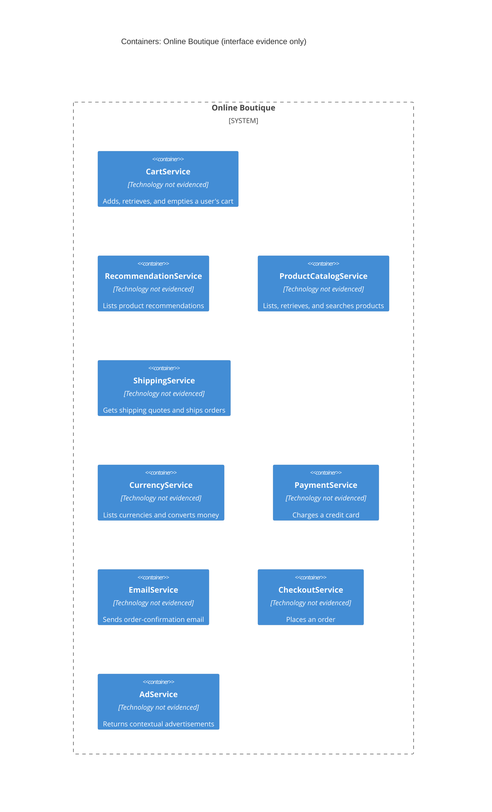

# Recovered C4 Container Architecture: Online Boutique

## Agent

GitHub Copilot using Copilot SDK in VS Code. The exact underlying model was not exposed.

## Files read

- `system/online-boutique/protos/demo.proto`

## Containers table

The `.proto` file declares service interfaces, but does not identify implementation languages, deployment units, ports, or data stores. Therefore, technology is recorded as **Not evidenced in the provided files**.

| Name | Technology/language | Responsibility | Evidence |
|---|---|---|---|
| `CartService` | Not evidenced in the provided files | Adds items to, retrieves, and empties a user's cart. | `system/online-boutique/protos/demo.proto` (`service CartService`) |
| `RecommendationService` | Not evidenced in the provided files | Lists product recommendations for a user and product context. | `system/online-boutique/protos/demo.proto` (`service RecommendationService`) |
| `ProductCatalogService` | Not evidenced in the provided files | Lists, retrieves, and searches products. | `system/online-boutique/protos/demo.proto` (`service ProductCatalogService`) |
| `ShippingService` | Not evidenced in the provided files | Gets shipping quotes and ships orders. | `system/online-boutique/protos/demo.proto` (`service ShippingService`) |
| `CurrencyService` | Not evidenced in the provided files | Lists supported currencies and converts money amounts. | `system/online-boutique/protos/demo.proto` (`service CurrencyService`) |
| `PaymentService` | Not evidenced in the provided files | Charges a credit card. | `system/online-boutique/protos/demo.proto` (`service PaymentService`) |
| `EmailService` | Not evidenced in the provided files | Sends an order-confirmation email. | `system/online-boutique/protos/demo.proto` (`service EmailService`) |
| `CheckoutService` | Not evidenced in the provided files | Places an order. | `system/online-boutique/protos/demo.proto` (`service CheckoutService`) |
| `AdService` | Not evidenced in the provided files | Returns advertisements for page-context keywords. | `system/online-boutique/protos/demo.proto` (`service AdService`) |

## Dependencies table

No runtime caller-to-callee dependency is evidenced by `demo.proto` alone. The file defines service contracts and message types, but it does not show which service calls another service.

| Caller → callee | Protocol | Evidence |
|---|---|---|
| None evidenced | Not evidenced in the provided files | `system/online-boutique/protos/demo.proto` contains service declarations, but no caller configuration or call sites. |

## Mermaid diagram

## Gaps

- The implementation language and runtime technology of every service are not evidenced. Service source files or build files would settle this.
- The deployment unit, network address, listening port, and transport configuration are not evidenced. Deployment manifests would settle this.
- The actual runtime dependencies between services are not evidenced. Service implementation code and deployment configuration would settle this.
- No user-facing frontend or external system is declared in this file, so none is included in the diagram. A deployment manifest or frontend interface would settle whether one exists.
- No data store or message broker is declared in this file.
- The `.proto` file alone does not establish whether the declared services communicate using gRPC at runtime, even though the syntax defines RPC methods. Client/server configuration or source code would settle the runtime protocol.
