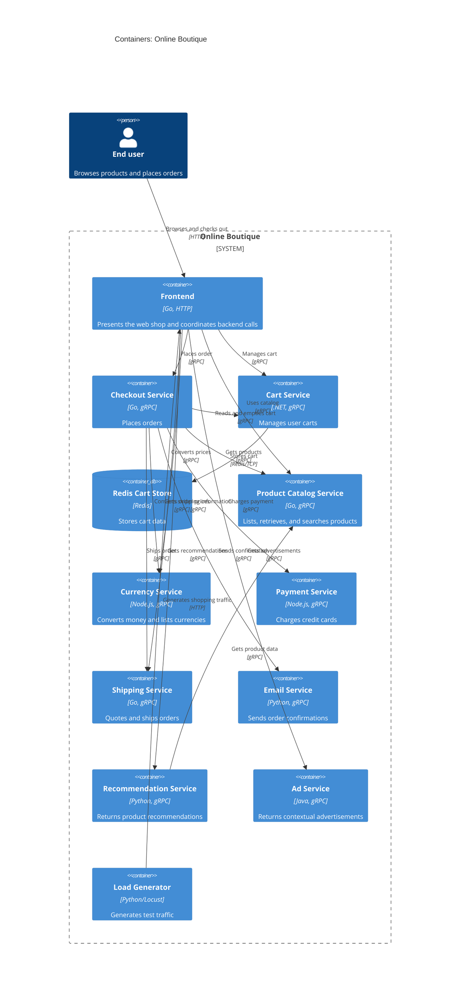

# Recovered C4 Container Architecture: Online Boutique

## Agent

GitHub Copilot using Copilot SDK in VS Code. The exact underlying model was not exposed.

## Files read

- `system/README.md`
- `system/online-boutique/kubernetes-manifests/kustomization.yaml`
- `system/online-boutique/kubernetes-manifests/frontend.yaml`
- `system/online-boutique/kubernetes-manifests/checkoutservice.yaml`
- `system/online-boutique/kubernetes-manifests/cartservice.yaml`
- `system/online-boutique/kubernetes-manifests/productcatalogservice.yaml`
- `system/online-boutique/kubernetes-manifests/currencyservice.yaml`
- `system/online-boutique/kubernetes-manifests/paymentservice.yaml`
- `system/online-boutique/kubernetes-manifests/shippingservice.yaml`
- `system/online-boutique/kubernetes-manifests/emailservice.yaml`
- `system/online-boutique/kubernetes-manifests/recommendationservice.yaml`
- `system/online-boutique/kubernetes-manifests/adservice.yaml`
- `system/online-boutique/kubernetes-manifests/loadgenerator.yaml`
- `system/online-boutique/protos/demo.proto`
- `system/online-boutique/src/frontend/Dockerfile`
- `system/online-boutique/src/checkoutservice/Dockerfile`
- `system/online-boutique/src/productcatalogservice/Dockerfile`
- `system/online-boutique/src/shippingservice/Dockerfile`
- `system/online-boutique/src/adservice/Dockerfile`
- `system/online-boutique/src/recommendationservice/Dockerfile`
- `system/online-boutique/src/emailservice/Dockerfile`
- `system/online-boutique/src/paymentservice/Dockerfile`
- `system/online-boutique/src/currencyservice/Dockerfile`
- `system/online-boutique/src/loadgenerator/Dockerfile`
- `system/online-boutique/src/shoppingassistantservice/Dockerfile`
- `system/online-boutique/src/cartservice/src/Dockerfile`

## Containers table

| Container | Technology/language | Responsibility | Evidence |
|---|---|---|---|
| `frontend` | Go; HTTP server on port 8080 | Presents the web shop to users and coordinates calls to catalog, currency, cart, recommendations, shipping, checkout, and advertising services. | `system/online-boutique/kubernetes-manifests/frontend.yaml` (`PORT`, `*_SERVICE_ADDR`); `system/online-boutique/src/frontend/Dockerfile` (`golang`, `go build`, port 8080) |
| `checkoutservice` | Go; gRPC server on port 5050 | Places orders and coordinates catalog, shipping, payment, email, currency, and cart operations. | `system/online-boutique/kubernetes-manifests/checkoutservice.yaml` (`*_SERVICE_ADDR`); `system/online-boutique/protos/demo.proto` (`CheckoutService.PlaceOrder`); `system/online-boutique/src/checkoutservice/Dockerfile` |
| `cartservice` | .NET; gRPC server on port 7070 | Adds, retrieves, and empties a user's cart. | `system/online-boutique/kubernetes-manifests/cartservice.yaml` (`REDIS_ADDR`); `system/online-boutique/protos/demo.proto` (`CartService`); `system/online-boutique/src/cartservice/src/Dockerfile` |
| `redis-cart` | Redis; TCP service on port 6379 | Stores cart data for `cartservice`. The manifest mounts an `emptyDir` at `/data`. | `system/online-boutique/kubernetes-manifests/cartservice.yaml` (`metadata.name: redis-cart`, `image: redis:alpine`, `emptyDir`) |
| `productcatalogservice` | Go; gRPC server on port 3550 | Lists, retrieves, and searches products. | `system/online-boutique/kubernetes-manifests/productcatalogservice.yaml`; `system/online-boutique/protos/demo.proto` (`ProductCatalogService`); `system/online-boutique/src/productcatalogservice/Dockerfile` |
| `currencyservice` | Node.js; gRPC server on port 7000 | Lists supported currencies and converts monetary amounts. | `system/online-boutique/kubernetes-manifests/currencyservice.yaml`; `system/online-boutique/protos/demo.proto` (`CurrencyService`); `system/online-boutique/src/currencyservice/Dockerfile` |
| `paymentservice` | Node.js; gRPC server on port 50051 | Charges a credit card and returns a transaction ID. | `system/online-boutique/kubernetes-manifests/paymentservice.yaml`; `system/online-boutique/protos/demo.proto` (`PaymentService.Charge`); `system/online-boutique/src/paymentservice/Dockerfile` |
| `shippingservice` | Go; gRPC server on port 50051 | Quotes shipping and ships an order. | `system/online-boutique/kubernetes-manifests/shippingservice.yaml`; `system/online-boutique/protos/demo.proto` (`ShippingService`); `system/online-boutique/src/shippingservice/Dockerfile` |
| `emailservice` | Python; gRPC server exposed through service port 5000 | Sends order-confirmation email. The container listens on port 8080 and the Kubernetes Service maps port 5000 to it. | `system/online-boutique/kubernetes-manifests/emailservice.yaml` (`port: 5000`, `targetPort: 8080`); `system/online-boutique/protos/demo.proto` (`EmailService.SendOrderConfirmation`); `system/online-boutique/src/emailservice/Dockerfile` |
| `recommendationservice` | Python; gRPC server on port 8080 | Returns product recommendations for a user and product context. | `system/online-boutique/kubernetes-manifests/recommendationservice.yaml` (`PRODUCT_CATALOG_SERVICE_ADDR`); `system/online-boutique/protos/demo.proto` (`RecommendationService`); `system/online-boutique/src/recommendationservice/Dockerfile` |
| `adservice` | Java; gRPC server on port 9555 | Returns advertisements for page-context keywords. | `system/online-boutique/kubernetes-manifests/adservice.yaml`; `system/online-boutique/protos/demo.proto` (`AdService.GetAds`); `system/online-boutique/src/adservice/Dockerfile` |
| `loadgenerator` | Python/Locust workload generator | Generates HTTP shopping traffic against the frontend; it is a test workload rather than a user-facing business service. | `system/online-boutique/kubernetes-manifests/loadgenerator.yaml` (`FRONTEND_ADDR`, `USERS`, `RATE`); `system/online-boutique/src/loadgenerator/Dockerfile` (`locust`) |

## Dependencies table

| Caller → callee | Protocol | Evidence |
|---|---|---|
| End user → `frontend` | HTTP | `system/online-boutique/kubernetes-manifests/frontend.yaml` (`frontend-external` Service of type `LoadBalancer`, port 80 → targetPort 8080) |
| `frontend` → `productcatalogservice` | gRPC | `system/online-boutique/kubernetes-manifests/frontend.yaml` (`PRODUCT_CATALOG_SERVICE_ADDR=productcatalogservice:3550`); `system/online-boutique/protos/demo.proto` (`ProductCatalogService`) |
| `frontend` → `currencyservice` | gRPC | `frontend.yaml` (`CURRENCY_SERVICE_ADDR=currencyservice:7000`); `demo.proto` (`CurrencyService`) |
| `frontend` → `cartservice` | gRPC | `frontend.yaml` (`CART_SERVICE_ADDR=cartservice:7070`); `demo.proto` (`CartService`) |
| `frontend` → `recommendationservice` | gRPC | `frontend.yaml` (`RECOMMENDATION_SERVICE_ADDR=recommendationservice:8080`); `demo.proto` (`RecommendationService`) |
| `frontend` → `shippingservice` | gRPC | `frontend.yaml` (`SHIPPING_SERVICE_ADDR=shippingservice:50051`); `demo.proto` (`ShippingService`) |
| `frontend` → `checkoutservice` | gRPC | `frontend.yaml` (`CHECKOUT_SERVICE_ADDR=checkoutservice:5050`); `demo.proto` (`CheckoutService`) |
| `frontend` → `adservice` | gRPC | `frontend.yaml` (`AD_SERVICE_ADDR=adservice:9555`); `demo.proto` (`AdService`) |
| `checkoutservice` → `productcatalogservice` | gRPC | `checkoutservice.yaml` (`PRODUCT_CATALOG_SERVICE_ADDR=productcatalogservice:3550`); `demo.proto` (`ProductCatalogService`) |
| `checkoutservice` → `shippingservice` | gRPC | `checkoutservice.yaml` (`SHIPPING_SERVICE_ADDR=shippingservice:50051`); `demo.proto` (`ShippingService`) |
| `checkoutservice` → `paymentservice` | gRPC | `checkoutservice.yaml` (`PAYMENT_SERVICE_ADDR=paymentservice:50051`); `demo.proto` (`PaymentService`) |
| `checkoutservice` → `emailservice` | gRPC | `checkoutservice.yaml` (`EMAIL_SERVICE_ADDR=emailservice:5000`); `demo.proto` (`EmailService`) |
| `checkoutservice` → `currencyservice` | gRPC | `checkoutservice.yaml` (`CURRENCY_SERVICE_ADDR=currencyservice:7000`); `demo.proto` (`CurrencyService`) |
| `checkoutservice` → `cartservice` | gRPC | `checkoutservice.yaml` (`CART_SERVICE_ADDR=cartservice:7070`); `demo.proto` (`CartService`) |
| `cartservice` → `redis-cart` | Redis protocol over TCP | `system/online-boutique/kubernetes-manifests/cartservice.yaml` (`REDIS_ADDR=redis-cart:6379`; `redis-cart` Service port 6379) |
| `recommendationservice` → `productcatalogservice` | gRPC | `system/online-boutique/kubernetes-manifests/recommendationservice.yaml` (`PRODUCT_CATALOG_SERVICE_ADDR=productcatalogservice:3550`); `demo.proto` (`ProductCatalogService`) |
| `loadgenerator` → `frontend` | HTTP | `system/online-boutique/kubernetes-manifests/loadgenerator.yaml` (`FRONTEND_ADDR=frontend:80`; init-container probes `http://${FRONTEND_ADDR}`) |

## Mermaid diagram

## Gaps

- `shoppingassistantservice` is present in `system/online-boutique/src/shoppingassistantservice/Dockerfile` and is referenced by the commented `SHOPPING_ASSISTANT_SERVICE_ADDR` setting in `frontend.yaml`, but no Kubernetes Deployment/Service for it is present in the provided manifests. Its runtime participation cannot therefore be proven, so it is excluded from the diagram. The missing deployment manifest or an enabled Kustomize component would settle this.
- The `loadgenerator` manifest exists but is commented out in `kustomization.yaml`; it is shown as an auxiliary test container because its manifest proves a frontend runtime dependency, but whether it belongs to the normal deployment is not evidenced. The deployment command or enabled workload configuration would settle this.
- The evidence does not show a durable database or persistent volume for product, order, payment, shipping, email, recommendation, currency, or advertisement data. The cart manifest explicitly uses an `emptyDir` for Redis, so durable persistence cannot be claimed.
- The evidence identifies service contracts and configured addresses, but does not prove retry, timeout, authentication, encryption, or failure-handling behavior. The relevant service implementation and client configuration files would settle those details.
